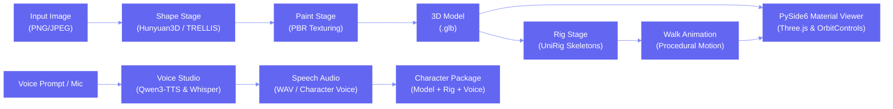

<div align="center">
  
  <h1>Model3D</h1>
  <p><strong>Local AI-powered 3D asset generation, skeletal rigging, and voice synthesis pipeline for Linux workstations.</strong></p>
  <p>
    <a href="https://github.com/ronald32acunadev/Model3dCreation"></a>
    
    
    
    
  </p>
</div>

**Model3D** is a local, GPU-accelerated pipeline that turns single 2D images into textured, rigged binary glTF 2.0 (`.glb`) 3D assets and pairs them with neural voice synthesis. Powered by **Hunyuan3D 2.1** and **TRELLIS.2** for geometry and PBR texturing, **UniRig** for skeletal rigging and skinning, and **Qwen3-TTS** and **Whisper** for voice design, voice cloning, and speech synthesis, Model3D operates entirely on your workstation without cloud dependencies or telemetry.

The project ships as a modular ecosystem: a high-throughput FastAPI/WebSocket inference server with dynamic multi-GPU orchestration, a native PySide6 desktop client featuring a custom Material Dark interface with an embedded Three.js 3D viewer, an interactive first-run setup wizard, a Blender 4.2+ extension, and a Debian package builder.

---

## Table of Contents

- [Key Features](#key-features)
- [Architecture & Workflow](#architecture--workflow)
- [How It Works & GPU Run Modes](#how-it-works--gpu-run-modes)
- [Prerequisites & Installation](#prerequisites--installation)
- [Usage](#usage)
  - [Desktop Application](#desktop-application)
  - [Local Inference Engine](#local-inference-engine)
  - [Blender Add-on](#blender-add-on)
  - [REST & WebSocket API Reference](#rest--websocket-api-reference)
  - [Environment Variables](#environment-variables)
  - [Diagnostic & Packaging Scripts](#diagnostic--packaging-scripts)
- [Development & Testing](#development--testing)
- [Troubleshooting & Platform Notes](#troubleshooting--platform-notes)
- [License](#license)

---

## Key Features

- **100% Local Image-to-3D Pipeline**: Converts images (`PNG`/`JPEG` up to 20 MB) into 3D meshes (`shape`), generates PBR textures (`paint`), and rigs skeletons (`rig`) into standard `.glb` assets without external network requests.
- **Voice Studio & Neural TTS**: Creates custom voices from natural-language descriptions or audio recordings via Qwen3-TTS 1.7B (VoiceDesign and Base models) and Whisper transcription. Generates speech audio clips and links voices to 3D characters.
- **Native Material Dark Desktop Client**: PySide6 client featuring a custom Material Design theme (Indigo `#6366f1` accent, elevated dark surfaces, customized controls, and real-time engine health indicators).
- **Standalone Skeletal Rigging & Walk Animations**: Rigs existing `.glb` models (up to 200 MB) with armatures and smoothed skinning weights using UniRig. Automatically detects morphology (biped or quadruped) and generates procedural looping walk animations.
- **Dynamic Multi-GPU Orchestration**: Inspects NVIDIA GPUs and PCIe bandwidth at startup, placing stages across two cards or dynamically swapping stage workers on a single GPU with zero VRAM consumption when idle.
- **First-Run Setup Wizard**: Automated machine auditor and installer supporting modular components (`base` for 3D generation, `skeletons` for UniRig, and `voice` for Qwen3-TTS & Whisper) with step fingerprinting and resumable downloads.
- **Blender 4.2+ Extension**: Native zero-dependency add-on connecting Blender directly to the local engine and model library via Python's standard `urllib`.

---

## Architecture & Workflow



### Subprojects Layout

The repository is organized into five independent [`uv`](https://docs.astral.sh/uv/) projects, each with its own `pyproject.toml` and test suite:

| Subproject | Package Name & Version | Python Requirement | Role |
| :--- | :--- | :--- | :--- |
| [`contracts/`](./contracts) | `model3d-contracts@0.1.0` | `>=3.11` | Shared Pydantic v2 schemas (`jobs`, `events`, `characters`, `health`). Editable dependency of `engine` and `client`. |
| [`engine/`](./engine) | `model3d-engine@0.1.0` | `==3.11.*` | FastAPI inference server (`python -m model3d_engine`), GPU probe, stage runners, job scheduler, and voice worker. |
| [`client/`](./client) | `model3d-client@0.2.0` | `>=3.11` | PySide6 MVVM desktop application (`python -m model3d_client`), Material Dark theme, setup wizard, and 3D viewer. |
| [`blender/`](./blender) | `model3d-blender@0.1.0` | `>=3.11` | Blender 4.2+ extension in [`blender/model3d/`](./blender/model3d) (`urllib` client, job tracker, and library browser). |
| [`packaging/`](./packaging) | `model3d-packaging@0.1.0` | `>=3.11` | Debian package builder ([`packaging/deb/build.sh`](./packaging/deb/build.sh)) and package verification suite. |

```text
Model3dCreation/
├── contracts/               # Shared Pydantic schemas (model3d_contracts)
├── engine/                  # FastAPI inference engine (model3d_engine)
│   ├── patches/             # hunyuan3d-paint-device.patch (multi-GPU device routing)
│   └── src/model3d_engine/  # api/, gpu/, jobs/, stages/, config.py, __main__.py
├── client/                  # PySide6 desktop application (model3d_client)
│   ├── launch.sh            # Universal shell launcher script
│   ├── scripts/             # update_translations.sh, test_system_python.sh
│   └── src/model3d_client/  # services/, setup/, viewmodels/, views/, viewer/, i18n/
├── blender/                 # Blender 4.2+ extension (blender/model3d/) and tests
├── packaging/               # Debian package build pipeline (packaging/deb/build.sh)
├── scripts/                 # Setup scripts, GPU verification, and VRAM benchmarks
└── docs/userstories/        # Feature backlogs, user stories, and QA traceability
```

### Runtime Storage Paths

| Path | Purpose |
| :--- | :--- |
| `$XDG_CONFIG_HOME/model3d/config.json` (fallback `~/.config/model3d/config.json`) | Pointer file written by the setup wizard storing the active installation directory. |
| `<install_or_repo>/install.json` | Step fingerprint state recorded by the setup wizard for resume and repair. |
| `$MODEL3D_HOME` (default `<install_or_repo>/data`) | Root data directory shared by the engine and desktop client. |
| `$MODEL3D_HOME/jobs/` | Job records, submitted images, and generated `.glb` outputs. |
| `$MODEL3D_HOME/library/` | Saved 3D models managed by the desktop client and accessed by Blender. |
| `$MODEL3D_HOME/voice_cache/` | Cached synthetic speech audio and voice samples. |
| `$MODEL3D_HOME/hf/` | Local Hugging Face cache for 3D model checkpoints and voice weights. |
| `$MODEL3D_HOME/logs/engine.log` | Engine runtime logs when supervised by the desktop client. |

---

## How It Works & GPU Run Modes

When `model3d_engine` starts, `model3d_engine.gpu.probe` and `model3d_engine.gpu.modes` inspect all visible NVIDIA GPUs and select one of five execution modes using a `512 MiB` safety margin above measured peak usage:

| Run Mode | Minimum Free VRAM | Behavior |
| :--- | :--- | :--- |
| `dual_gpu` | Two GPUs (`>= 10.4 GiB` paint, `>= 9.2 GiB` shape) | Runs `shape` on one GPU and `paint` on the card with the most free VRAM (tie-broken by PCIe bandwidth). `rig` and `voice` stages share available GPU capacity. |
| `single_gpu_resident` | One GPU (`>= 17.5 GiB` free) | `shape` and `paint` stages take turns on the same GPU, loaded one at a time. |
| `single_gpu_swap` | One GPU (`>= 10.4 GiB` free) | Runs `shape` and `paint` sequentially on a single GPU, unloading each worker process between stages to conserve memory. |
| `shape_only` | One GPU (`>= 9.2 GiB` free) | Generates untextured meshes (`"texture": false`) and optional rigging when VRAM is insufficient for `paint`. |
| `unsupported` | Below `9.2 GiB` free or no compatible GPU | Starts the HTTP API in diagnostic mode so `/v1/health` reports hardware bottlenecks; job requests return `503 engine_not_ready`. |

### Generation Quality Presets

| Preset (`quality`) | Description |
| :--- | :--- |
| `draft` | Rapid preview generation with reduced diffusion steps. |
| `final` | Balanced production quality (default setting). |
| `high` | Maximum geometry resolution and texture detail. |

### Alternative Generator: TRELLIS.2

Setting `MODEL3D_GENERATOR=trellis2` replaces the Hunyuan3D shape and paint pipeline with [TRELLIS.2](https://github.com/microsoft/TRELLIS.2), generating geometry and PBR textures in a unified model for crisper surface details. With dual GPUs, decoding and texture baking (~10.1 GiB) run on the primary card while image encoding and flow models (~5.2 GiB) run on the secondary card.

> [!NOTE]
> TRELLIS.2 requires manual environment preparation (`vendor/TRELLIS.2/.venv` with Python 3.11, PyTorch cu130, `xformers`, and custom compiled CUDA kernels for `nvdiffrast`, `CuMesh`, and `FlexGEMM`). Model checkpoints (`microsoft/TRELLIS.2-4B`) reside in `$MODEL3D_HOME/hf`.

---

## Prerequisites & Installation

### Hardware & System Requirements

- **Operating System**: Linux `x86_64` (Ubuntu 24.04 / 26.04 recommended).
- **GPU**: NVIDIA GPU(s) with compute capability `sm_120` (e.g., GeForce RTX 5070 12 GB) and an NVIDIA driver supporting CUDA 13.
- **Build Toolchain**: CUDA Toolkit 13 (`nvcc`), `build-essential` (`gcc`, `g++`), and `patch` (required to compile native rasterizers and image processors).
- **Storage**: ~31 GB for base models (Hunyuan3D 2.1 + DINOv2 + BiRefNet), ~8 GB for UniRig rigging, and ~8.5 GB for Qwen3-TTS and Whisper voice models (~48 GB total recommended).

### Option 1: Debian Package (`.deb`)

Build and install the standalone system package:

```bash
packaging/deb/build.sh
sudo apt install ./dist/model3d_0.2.0_amd64.deb
```

Launch `model3d` from your application launcher or terminal. The first-run Setup Wizard will verify drivers and download components.

### Option 2: Automated Setup Script

Run the automated installer from the repository root:

```bash
# Full installation on Ubuntu (system tools, CUDA 13.2, Python venvs, models, Blender)
scripts/setup/setup-ubuntu.sh
```

Pass `--dry-run` to preview operations, or `--no-rig` / `--no-trellis` to skip optional components.

### Option 3: Development Setup with `uv`

1. Install [`uv`](https://docs.astral.sh/uv/) and verify that Python 3.11 and `nvcc` are on your PATH.
2. Clone external vendor dependencies and apply required patches:
   ```bash
   git clone --depth 1 https://github.com/Tencent-Hunyuan/Hunyuan3D-2.1.git vendor/Hunyuan3D-2.1
   git apply --directory=vendor/Hunyuan3D-2.1 engine/patches/hunyuan3d-paint-device.patch
   ```
3. Synchronize subproject environments:
   ```bash
   (cd contracts && uv sync)
   (cd client && uv sync)
   (cd engine && uv sync)
   ```

> [!TIP]
> The desktop client's Setup Wizard (`./client/launch.sh`) can automatically install and repair all missing components (`base`, `skeletons`, and `voice`) directly into the repository.

---

## Usage

### Desktop Application

Start the client (which supervises the local engine automatically):

```bash
# Using the launcher script from anywhere
./client/launch.sh

# Or directly through uv from the repository root
uv run --project client python -m model3d_client
```

#### 1. 3D Model Generation & Embedded Viewer
- **Generation Panel**: Drag and drop input images (`PNG` or `JPEG`), toggle PBR texturing, toggle skeletal rigging, and select quality presets.
- **Embedded Three.js Viewer**: Render models inside QtWebEngine with OrbitControls (pan, rotate, zoom), texture toggle, camera reset, and studio lighting.
- **Walk Animation Preview**: Rigged models with procedural walk cycles can be previewed directly with Play/Pause controls.

#### 2. Voice Studio
- **Voice Creation**: Design custom synthetic voices from descriptive text prompts (e.g., *"A warm, deep male narrator"*) or clone voices from microphone recordings.
- **Speech Synthesis**: Generate spoken audio clips in Spanish or English from text inputs, preview waveforms, and export audio as standard `.wav` files.
- **In-App Model Installer**: When the voice stage is missing, an *"Install voice models…"* action in the banner opens the setup wizard in background resume mode and restarts the engine upon completion.

#### 3. Model Library & Character Management
- **Seed Regeneration**: Re-run original inputs with a new random seed to generate variations without overwriting existing entries.
- **Add Skeleton**: Rig library models on demand using UniRig.
- **Add Walk Animation**: Detect biped or quadruped morphology and attach a procedural walk cycle.
- **Character Packaging**: Group 3D models with associated voice profiles into distributable character packages.
- **Multi-Format Export**: Convert library assets to major industry formats:

| Format | Textures | Skeleton | Animation | Files Written |
| :--- | :--- | :--- | :--- | :--- |
| **GLB** | Yes | Yes | Yes | 1 (`.glb`) |
| **FBX** | Yes (embedded) | Yes | Yes | 1 (`.fbx`) |
| **OBJ + MTL** | Yes | No | No | `.obj`, `.mtl`, texture images |
| **STL** | No | No | No | 1 (`.stl`) |
| **USDZ** | Yes (packaged) | Viewer-dependent | No | 1 (`.usdz`) |

### Local Inference Engine

Run the FastAPI engine standalone (binds to loopback `127.0.0.1:8765` by default):

```bash
uv run --project engine python -m model3d_engine
```

### Blender Add-on

The Blender extension is located in [`blender/model3d/`](./blender/model3d) (or `/opt/model3d/blender/model3d.zip` when installed from `.deb`).
- Compatible with **Blender 4.2.0 or newer**.
- Install via **Edit → Preferences → Add-ons → Install from Disk** (`model3d.zip`).
- Access the **Model3D** sidebar to generate models, rig existing meshes, and import assets directly from the local library.

### REST & WebSocket API Reference

The engine restricts incoming traffic to loopback addresses by default (`LoopbackGuard`).

| Method & Path | Description | Payload / Parameters |
| :--- | :--- | :--- |
| `GET /v1/health` | Engine readiness, active run mode, per-GPU VRAM, and stage availability. | None |
| `POST /v1/jobs` | Submit image for 3D generation. Returns `202 Accepted` with `Job` payload. | `multipart/form-data`: `image`, `options` (JSON string) |
| `POST /v1/rig-jobs` | Submit existing `.glb` file (up to 200 MB) for standalone UniRig rigging. | `multipart/form-data`: `model` (`.glb` file) |
| `GET /v1/jobs/{job_id}` | Polling route for job state (`queued`, `shaping`, `painting`, `rigging`, `succeeded`, `failed`). | Path param: `job_id` |
| `GET /v1/jobs/{job_id}/result` | Download generated binary model (`model/gltf-binary`). | Path param: `job_id` |
| `DELETE /v1/jobs/{job_id}` | Cancel active or queued generation task. | Path param: `job_id` |
| `WS /v1/jobs/{job_id}/events` | WebSocket channel streaming real-time JSON `JobEvent` notifications. | Path param: `job_id` |
| `GET /v1/voices` | List all saved synthetic and cloned voices. | None |
| `POST /v1/voices` | Create a new voice profile from prompt or recorded reference. | JSON: `name`, `kind`, `prompt`, `reference_audio` |
| `POST /v1/speech-jobs` | Request TTS speech generation from text and voice ID. Returns `Job`. | JSON: `voice_id`, `text`, `language` |
| `GET /v1/speech-jobs/{job_id}/result` | Download synthetic speech audio (`audio/wav`). | Path param: `job_id` |
| `GET /v1/characters` | List saved character packages with linked model and voice data. | None |
| `POST /v1/characters/{id}/speech` | Generate a voice phrase for a character. | JSON: `text`, `language` |

#### `JobOptions` Schema (`POST /v1/jobs`)

```json
{
  "texture": true,
  "quality": "final",
  "seed": 1234,
  "remove_background": true,
  "target_faces": 50000,
  "rig": false
}
```

### Environment Variables

| Variable | Default | Description |
| :--- | :--- | :--- |
| `MODEL3D_HOME` | `<repo_or_install>/data` | Root runtime directory (`jobs/`, `library/`, `voice_cache/`, `hf/`, `logs/`). |
| `MODEL3D_HUNYUAN_DIR` | `<repo_or_install>/vendor/Hunyuan3D-2.1` | Location of patched Hunyuan3D 2.1 repository. |
| `MODEL3D_UNIRIG_DIR` | `<repo_or_install>/vendor/UniRig` | Location of UniRig repository containing its `.venv`. |
| `MODEL3D_TRELLIS_DIR` | `<repo_or_install>/vendor/TRELLIS.2` | Location of TRELLIS.2 repository and `.venv`. |
| `MODEL3D_QWEN_TTS_DIR` | `<repo_or_install>/vendor/Qwen3-TTS` | Location of Qwen3-TTS repository and `.venv`. |
| `MODEL3D_HOST` | `127.0.0.1` | Loopback bind address (`127.0.0.1`, `::1`, or `localhost`). |
| `MODEL3D_PORT` | `8765` | TCP port for the FastAPI server. |
| `MODEL3D_LAN_HOST` | None | Optional secondary bind address for local network access. |
| `MODEL3D_API_KEYS` | `""` | Comma-separated API keys required when accessed over LAN. |
| `MODEL3D_MODE` | *(auto-detected)* | Force run mode: `dual_gpu`, `single_gpu_resident`, `single_gpu_swap`, or `shape_only`. |
| `MODEL3D_SHAPE_BUS` | *(auto-detected)* | Explicit PCI bus ID for shape worker (e.g., `0000:01:00.0`). Set with `MODEL3D_PAINT_BUS`. |
| `MODEL3D_PAINT_BUS` | *(auto-detected)* | Explicit PCI bus ID for paint worker (e.g., `0000:29:00.0`). Set with `MODEL3D_SHAPE_BUS`. |
| `MODEL3D_ALLOWED_ORIGINS` | `""` | Comma-separated browser `Origin` headers permitted for mutating requests. |
| `MODEL3D_GENERATOR` | `hunyuan` | 3D generator backend: `hunyuan` or `trellis2`. |
| `MODEL3D_STAGE_TIMEOUT_S` | `900` | Maximum execution timeout (seconds) per worker task before recycle. |

### Diagnostic & Packaging Scripts

| Command | Arguments / Flags | Description |
| :--- | :--- | :--- |
| `uv run --project engine python scripts/verify_gpus.py` | None | Verifies PyTorch CUDA 13 build, `sm_120` support, GPU topology, `nvcc` match, and compiled rasterizers. |
| `uv run --project engine python scripts/measure_stage_vram.py` | `[--bus BUS_ID] [--image PATH] [--qualities Q]` | Benchmarks idle, loaded, and peak VRAM across quality presets on target GPU. |
| `scripts/setup/setup-ubuntu.sh` | `[--dry-run] [--no-rig] [--no-trellis]` | Automated full installation for Ubuntu workstations. |
| `scripts\setup\setup-windows.ps1` | `[-DryRun] [-NoRig] [-NoTrellis]` | Windows client and vendor setup. |
| `scripts/setup/setup-macos.sh` | `[--dry-run]` | macOS client environment setup. |
| `scripts/configure_ollama_models.sh` | Run with `sudo` | Configures system Ollama storage directory and systemd drop-in. |
| `python3 scripts/ask_local_llm.py` | `--user REQ.md --out ANS.md [--provider lmstudio\|ollama]` | Queries local LLM servers (LM Studio or Ollama) with project rules and zero reasoning effort. |
| `packaging/deb/build.sh` | `[--out DIR]`, `UV_BINARY=/path/to/uv` | Builds standalone `model3d_<version>_amd64.deb` system package. |
| `client/scripts/update_translations.sh` | None | Synchronizes UI translation catalogs (`model3d_es.ts` and `model3d_es.qm`). |
| `client/scripts/test_system_python.sh` | `[pytest args...]` | Validates client suite against system Python 3 and apt-installed Qt packages. |

---

## Development & Testing

Subprojects isolate unit and integration tests so the full test suite runs deterministically without GPU hardware:

```bash
# Run fast unit and mock integration suites across all projects
uv run --project contracts pytest
uv run --project engine pytest
uv run --project client pytest
uv run --project blender pytest
uv run --project packaging pytest
```

### Running Hardware & Integration Marker Suites

```bash
# Engine & Client GPU acceptance tests (requires NVIDIA GPUs + full engine environment)
uv run --project engine pytest -m gpu
uv run --project client pytest -m gpu

# Client QtWebEngine viewer tests (requires an active display with GPU rendering)
uv run --project client pytest -m webengine

# Blender smoke tests (requires system blender or in-repo vendor/blender)
uv run --project blender pytest -m blender
cd blender && PATH="$PWD/../vendor/blender:$PATH" uv run pytest -m blender
```

---

## Troubleshooting & Platform Notes

- **`gpu_busy` / Insufficient VRAM**: Close external GPU-intensive programs (LM Studio, Ollama, games) before launching generation tasks or running stage VRAM benchmarks.
- **`CUDA_DEVICE_ORDER` Mismatch**: The engine enforces `CUDA_DEVICE_ORDER=PCI_BUS_ID` to ensure device indices in PyTorch match physical `nvidia-smi` bus slots.
- **Dependency Version Pinning**: Native modules require strict versions (`Python ==3.11.*` for `bpy==4.5.*` wheels, `numpy==1.26.4`, `trimesh==4.4.7` for positional quadric decimation, `onnxruntime>=1.20` for glibc 2.41+ stack compatibility, and `setuptools<81` for `pkg_resources`). See [`engine/pyproject.toml`](./engine/pyproject.toml) comments for details.

---

## License

The Blender add-on ([`blender/model3d/blender_manifest.toml`](./blender/model3d/blender_manifest.toml)) is licensed under `SPDX:GPL-3.0-or-later`.
